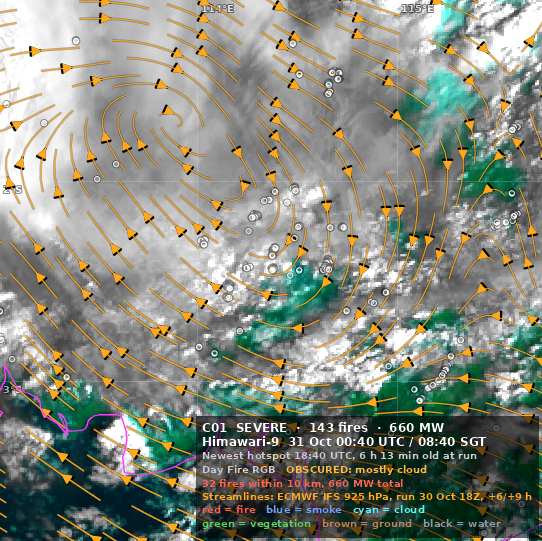

# Latest fire map run

Run `20261031_0053Z` (status: **ok**). Open the map website for the interactive view.

- Himawari-9 scan: 2026-10-31 00:40 UTC / 2026-10-31 08:40 SGT
- Newest VIIRS hotspot: 2026-10-30T19:41:35Z (312 min old at run time)
- Fires: 673 distinct, 1,866 MW in total
- Flagged: **1 severe**, 0 watch (0 getting worse); 1 imaged, 0 only on the overview
- Winds: ECMWF IFS 925 hPa, run 30 Oct 18Z, +6/+9 h

## C01 SEVERE: 143 fires, 660 MW

Why: 32 fires within 10 km, 660 MW total

Centroid -2.37, 114.37; mode: day (obscured by cloud)

---
Data: NOAA VIIRS EFIRE, JMA Himawari-9 via NOAA NODD, ECMWF open data (CC-BY-4.0). Streamlines are model output, not observations.
